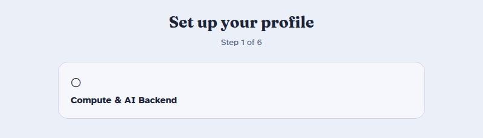
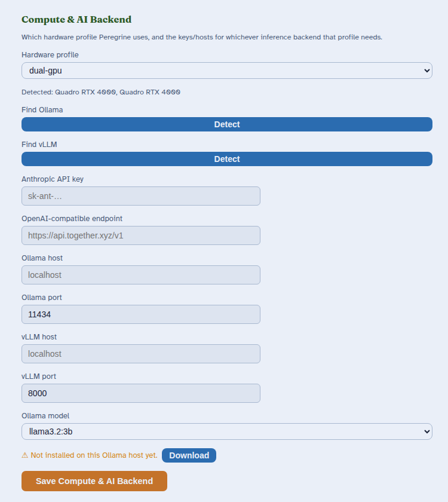
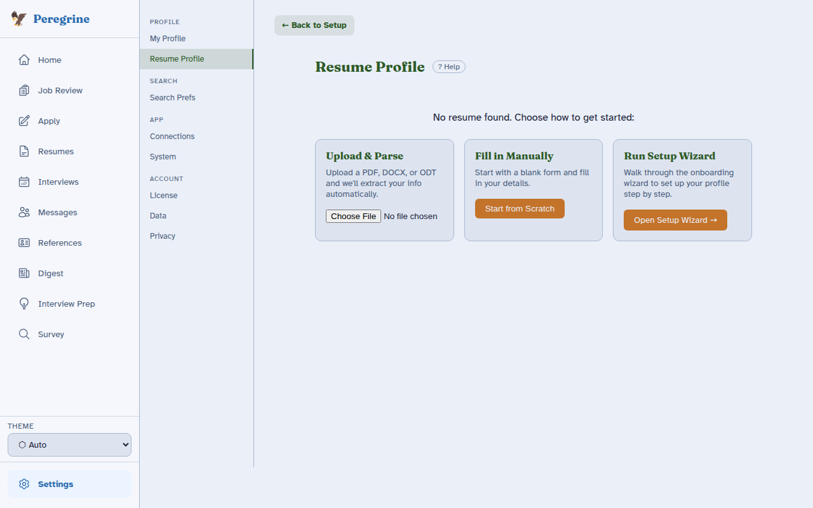
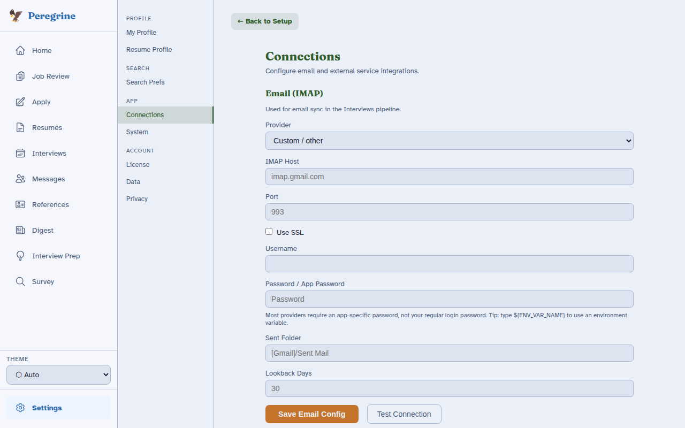
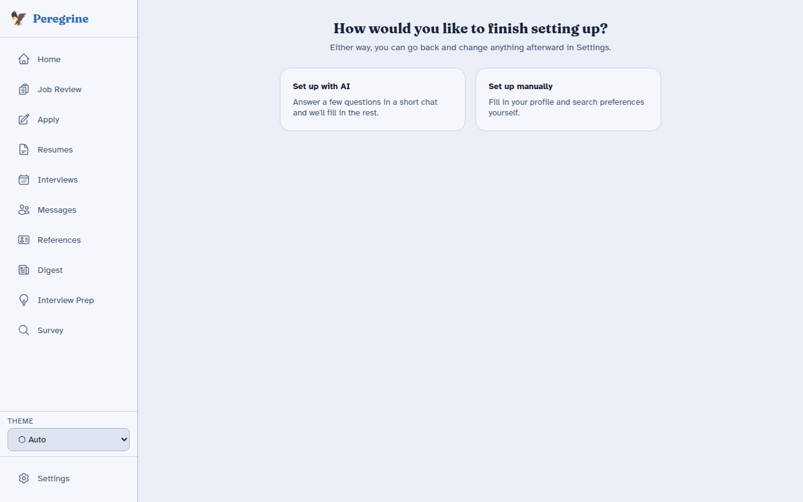
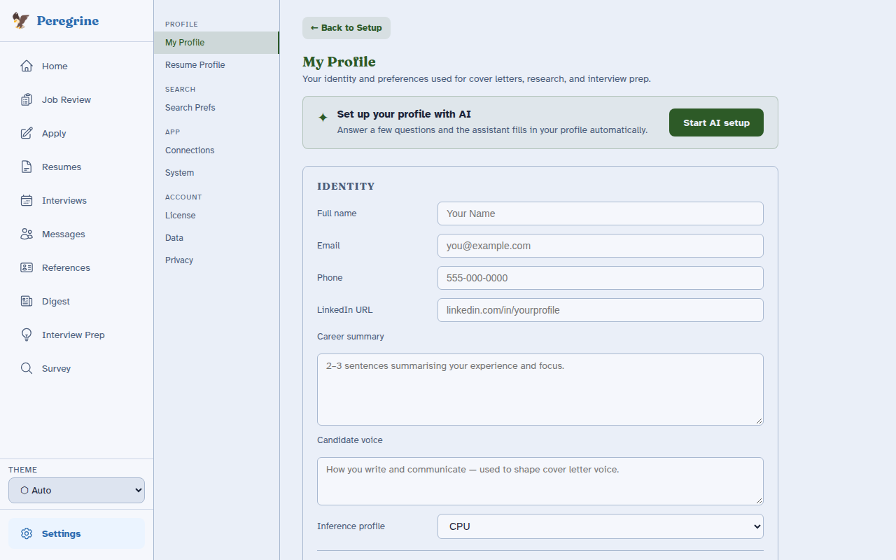
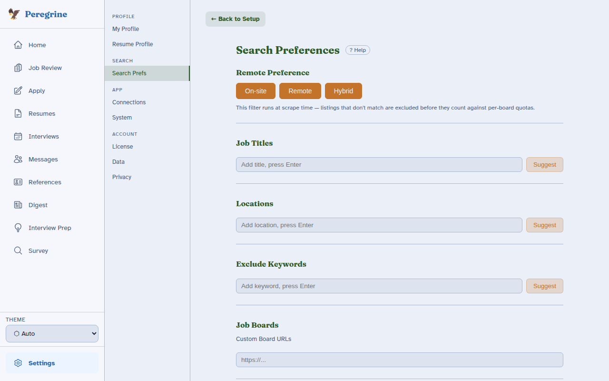

# Your First Setup

The first time you open Peregrine, it walks you through a short setup. It takes about ten minutes, and you can stop and come back whenever you like. Peregrine remembers what you have finished.

You will tell Peregrine three things: who you are, what your resume says, and what kind of jobs you want. Everything else is optional.

---

## How the checklist works

The setup page is a short checklist titled **Set up your profile**. It shows one step at a time. When you finish a step, a check mark appears beside it and the next step shows up below.

- Click any step to open it. Click a finished step again to change it.
- Each step opens a normal settings page. Use **← Back to Setup** in the top left to return to the checklist.
- Nothing here is permanent. You can change every answer later in **Settings**.
- A **Finish Setup** button appears once your profile, resume, and search preferences are filled in.

The checklist has up to six steps. The first one is skipped on the hosted (cloud) version of Peregrine, so you may only see five.

---

## Step 1: Compute & AI Backend (self-hosted only)

Peregrine uses a language model, or LLM, to draft cover letters and research companies. This step tells Peregrine where that model runs.

If you use the hosted version, this step does not appear. Skip ahead to Step 2.

What to do here:

1. Look at **Hardware profile**. Peregrine detects your graphics card and picks a sensible default.
2. If you already run a local model server such as Ollama, click **Detect** beside it. Peregrine looks for it on your machine.
3. If you would rather use an online model, paste your key into **Anthropic API key** or fill in the **OpenAI-compatible endpoint**.
4. Click **Save Compute & AI Backend**.

You do not need all of this. One working model is enough. If you are unsure, take the default and move on. You can come back from **Settings → System**.

!!! tip "Your data stays yours"
    A local model runs entirely on your own computer. Nothing you write is sent anywhere. If you use an online model with your own key, only the text for that one request is sent to that provider.

---

## Step 2: Resume

Peregrine reads your resume to learn your skills and to write letters that sound like you. Pick whichever start feels easiest.

| Choice | Best when |
|--------|-----------|
| **Upload & Parse** | You have a resume file (PDF, DOCX, or ODT). Peregrine pulls out your jobs, schooling, and skills for you to review. |
| **Fill in Manually** | You do not have a file handy, or you want full control. You start from a blank form. |

Self-hosted installs also show a third card, **Run Setup Wizard**. It simply brings you back to this checklist, so you can ignore it here.

After an upload, read what Peregrine found. Reading software sometimes misses a job or mixes up dates, so check each section and fix anything that looks off.

---

## Step 3: Connections (optional)

Connections link Peregrine to your email and other services. They are entirely optional, and you can add them any time.

You have two buttons:

- **Configure Connections** opens the connections page so you can link your email now.
- **Continue** skips this step. Choose this if you are not sure yet.

Linking email lets Peregrine watch for replies and move your jobs along automatically. See [Email Sync](../user-guide/email-sync.md) for what it does and does not do.

---

## Step 4: Choose how to finish

Now you pick how to fill in your profile and search preferences.

**Set up with AI** is a short chat. The assistant asks you a few questions, one at a time, and fills in your profile and search preferences from your answers. A progress bar shows how many of eight fields it has captured, and you can skip any question.

**Set up manually** takes you to the forms yourself. It is just as complete, only quieter.

Either way you review everything before it is saved, and either way you can change it later. A language model drafts, and you decide.

!!! note "Who can use the chat"
    **Set up with AI** is included with a Paid plan. On the Free plan it unlocks when you add your own LLM key in Step 1. New hosted accounts can use it during first setup. If it is locked, the card says so, and **Set up manually** works for everyone.

---

## Step 5: Profile

This is the personal information Peregrine uses in cover letters and company research.

Fill in your name and contact details, then write a **Career summary** of two or three sentences. This summary shapes every letter Peregrine drafts, so a few honest, specific lines beat a long generic paragraph.

**Candidate voice** is optional. Describe how you like to sound, for example "warm and direct, no buzzwords", and drafts will follow it.

---

## Step 6: Search Preferences

This tells Peregrine what to look for.

1. Choose **On-site**, **Remote**, **Hybrid**, or any mix under **Remote Preference**.
2. Add a few **Job Titles**. Type one and press Enter.
3. Add **Locations**. Leave this empty if you want no location limit.
4. Add **Exclude Keywords** for words that mean a job is not for you, such as a seniority level or a field you are leaving.
5. Click **Save Search Preferences** at the bottom of the page.

Stuck for ideas? Click **Suggest** beside a field. The assistant offers options based on your resume, and you click the ones you want. Nothing is added until you choose it.

---

## Finishing

When your profile, resume, and search preferences are filled in, a **Finish Setup** button appears at the bottom of the checklist. Click it.

Peregrine takes you to the home page and starts your first discovery run in the background. Within a few minutes your first jobs appear in **Job Review**. Continue with [Job Discovery](../user-guide/job-discovery.md) to see what happens next, or jump to the [Daily Workflow](../user-guide/daily-workflow.md).

---

## If you close the window

Your progress is saved after every step. Open Peregrine again and the checklist picks up where you stopped. Nothing is lost.

---

??? note "For self-hosters and developers"
    **Hardware profile.** Peregrine detects NVIDIA GPUs with `nvidia-smi` and recommends a Docker Compose profile: `remote` (no GPU), `cpu` (under 4 GB of video memory), `single-gpu`, or `dual-gpu`. The choice is stored as `inference_profile` in `config/user.yaml`. See [Docker Profiles](docker-profiles.md).

    **Where setup data lives.** Identity and tier are saved in `config/user.yaml`. Language model backends are saved in `config/llm.yaml`, in the priority order shown under **Settings → System**. Search settings are saved in `config/search_profiles.yaml`.

    **Completion flag.** Setup is complete when `wizard_complete: true` is set in `config/user.yaml`. The checklist reads live status from `/api/wizard/status`, so a step counts as done based on the data that exists, not on a click.

    **Run setup again.** Open **Settings → Developer** (visible only in dev mode) and click **Reset Setup Wizard**. Your earlier answers are kept as defaults.

    **Tiers and unlocks.** See the [Tier System](../reference/tier-system.md) for which features need a Paid plan and which unlock with your own key.
