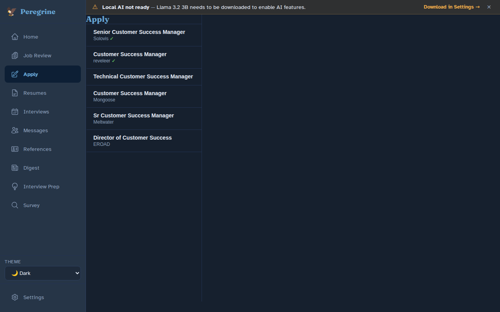

# Apply Workspace

{ .only-light }
{ .only-dark }

The Apply Workspace is where you generate cover letters, export application documents, and record that you have applied to a job.

---

## Accessing the Workspace

Navigate to page **4 — Apply** in the sidebar. The workspace lists all jobs with status `approved`, sorted by date approved.

---

## Cover Letter Generation

Click **Generate Cover Letter** on any job card. Peregrine runs as a background task so you can continue navigating the UI.

### What the generator uses

- Your **career summary** and **resume data** from `config/user.yaml`
- The **job title** and **job description**
- **Company name** — used to detect mission-aligned industries
- **Mission alignment notes** from `config/user.yaml` (e.g. a personal note about why you care about music-industry companies)

### Fallback chain

Cover letters use the cover letter fallback order from `config/llm.yaml`. By default: `ollama → claude_code → vllm → github_copilot → anthropic`. See [LLM Router](../reference/llm-router.md) for details.

### Mission alignment

If the company or job description matches one of your configured mission industries (music, animal welfare, education), the generator injects a personalised paragraph 3 hint into the prompt. This produces a cover letter that reflects authentic alignment rather than generic enthusiasm.

---

## Editing the Cover Letter

After generation, the cover letter appears in an editable text area. Edit freely — changes are saved locally and do not trigger a re-generation.

Click **Save** to write the updated text back to the database.

---

## PDF Export

Click **Export PDF** to generate a formatted PDF of the cover letter. The PDF is saved to your `docs_dir` (configured in `config/user.yaml`, default: `~/Documents/JobSearch`).

The filename format is: `{Company}_{Title}_{Date}_CoverLetter.pdf`

---

## ATS Resume Optimizer

The optimizer helps your resume match a job. ATS means applicant tracking system, the software many employers use to filter resumes by keyword. The optimizer has two steps.

1. Click **Analyze Keywords**. Peregrine lists the keywords from the job that your resume is missing. Use the checkboxes to choose which keywords you want to target. Only the ones you tick are used.
2. Click **Optimize Resume** to rewrite your resume toward those keywords. This button is not shown on the free tier.

### Questions before the rewrite

Before anything is rewritten, Peregrine asks one short question for the keywords you selected, up to 6 at a time. The most important keywords come first. You pick one answer:

- **Yes, I have done this**: add a few words of your own about it.
- **Something similar**: add a few words about what you did that is close.
- **No, not something I have done**: the keyword is left out.
- **Skip for now**: the keyword is left out this time, and you can answer later.

Your answers are saved in your own account and reused on later jobs. Keywords you already answered with something usable do not get a card. They are gathered into one line, **Use my N saved answers**, which is ticked by default. Open **See my saved answers** to read each one, and untick the box if you do not want them used this time. Keywords you answered before with No, or kept private, are listed under **Answered, not used**. Choose **Change** next to one to answer it again.

If more keywords still need an answer, the extra ones wait. Choose the **Save and ask about...** button to save what you have and see the next group, or **Save answers and continue** to go straight to the rewrite. Keywords you never answered are simply not used.

If you only answered a similar keyword before, that answer is shown as a hint with the keyword it was saved for, and the card starts on **Skip for now** until you choose.

Tick **Keep this private** if you want an answer saved for you but never used in your documents.

### What the rewrite uses

The rewrite only uses keywords you answered "Yes" or "Something similar" to in this round of questions, and only when the answer is not private. Keywords you said No to, kept private, skipped or did not answer are not used. If none of your answers can be used, no rewrite starts and the panel says "Nothing to rewrite. None of your answers can be used in a resume yet." Choose **Optimize Resume** to change your answers.

### Checking the result

On the review step, you may see a short notice called **A few things to check**. It lists:

- Words that appear in the rewritten resume but not in your original resume or your saved answers. Please check that each one is true for you. This list is a rough automatic check, so it can include harmless rewordings.
- Keywords that were not used, because you said No, kept your answer private, skipped them, or have not answered yet.

You decide what goes into the final resume. Nothing is applied until you approve it.

To look at, edit or remove your saved answers, see **My Experience** in [Settings](settings.md#my-experience).

---

## Marking Applied

Once you have submitted your application externally, click **Mark Applied**. This:

- Sets the job status to `applied`
- Records `applied_at` timestamp
- Moves the job out of the Apply Workspace and into the Interviews kanban (in `applied` pre-stage)

---

## Rejecting a Listing

Changed your mind about a job you approved? Click **Reject Listing** to set it to `rejected` status. This removes it from the workspace without affecting your cover letter draft (the text remains in the database).

---

## Cover Letter Background Task Status

The sidebar shows a live indicator (updated every 3 seconds) of running and queued background tasks. If a cover letter generation is in progress you will see it there.

A task can have these statuses:
- **queued** — waiting to start
- **running** — actively generating
- **completed** — finished; reload the page to see the result
- **failed** — generation failed; check the logs

Only one queued or running task per job is allowed at a time. Clicking **Generate Cover Letter** on a job that already has a task in progress is a no-op.
