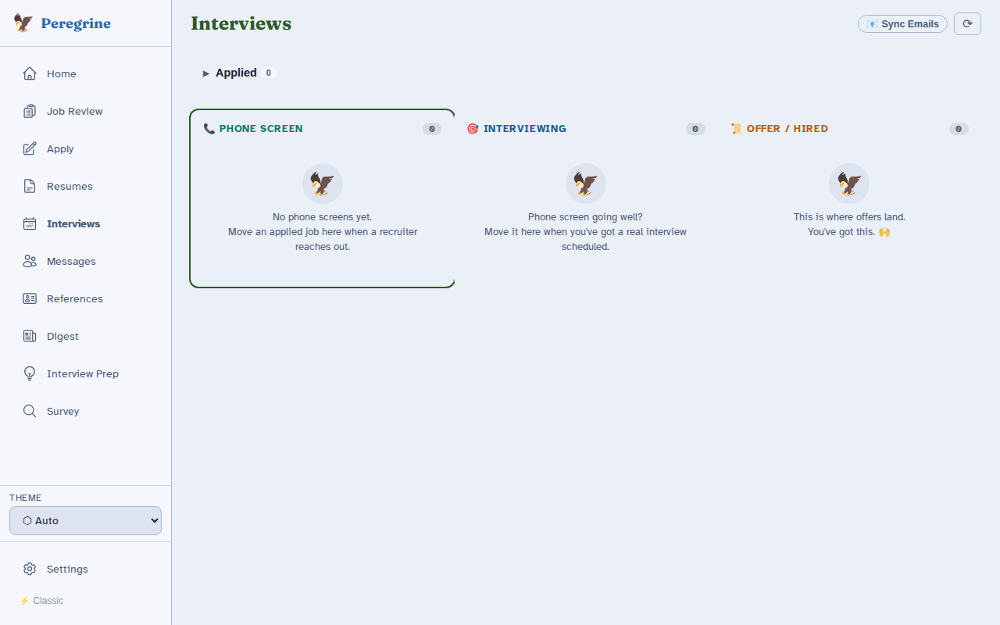

# Interviews

The **Interviews** page is where you keep track of every application after you have sent it, from the first reply through to an offer.

## What you will do here

1. Open **Interviews** in the sidebar. You will see your **Applied** list at the top and three columns below it.
2. When a company replies, click **Move to…** on the job and pick the next step. The job jumps to its new column.
3. Add the date and time of your call. It shows on the card as a small chip, like "Tomorrow 2:00 PM".
4. Click **Research** or **Prep →** on a card to get ready for the conversation.
5. Mark the job **Hired** when you accept an offer, or **Rejected** if it ends. Both are normal parts of a job search, and nothing is lost.

## What are the stages?

Every job sits in one of these places. The names below are exactly what you see in the app.

| Where you see it | What it means |
|---|---|
| **Applied** (list at the top) | You applied and have not heard back yet. |
| **Survey** (shown in the same list, with a small **Survey** tag) | The company sent you a questionnaire or assessment. |
| **Phone Screen** (first column) | A recruiter call is booked or done. |
| **Interviewing** (second column) | You are in the real interview rounds. |
| **Offer / Hired** (third column) | You have an offer, or you accepted one. |
| **Rejected** (collapsed list at the bottom) | The company said no, or went quiet. |

The **Applied** list is open by default. Click its title to fold it away. If you have more than ten jobs in it, use the arrows at the bottom to flip between pages.

## How do I move a job to the next stage?

1. Click **Move to… ›** on the job. On the Applied list it sits at the right of the row. On a column card it sits in the card footer.
2. Pick a stage from the list that opens. The stage the job is already in is not shown.
3. If you pick **Phone Screen** or **Interviewing**, you can add an **Interview date/time (optional)**.
4. If you pick **Rejected**, you can choose **Rejected after…** and select **Application**, **Phone screen**, **Interviewing**, or **Offer stage**. This is optional. It only helps you see where applications tend to end.
5. Click **Move →**.

There is no drag and drop. If you prefer the keyboard, use the arrow keys (or **J** and **K**) to pick a card, **[** and **]** to change column, **M** to open **Move to…**, and **Enter** to open the prep page.

Moved something by mistake? Open **Move to…** again and choose the right stage. You can also bring a job back from **Rejected** with the **Move →** button on its row.

## What is the date chip on a card?

Cards in **Phone Screen** and **Interviewing** have a date and time field. Set it once and the card shows a chip with "Today", "Tomorrow", a weekday, or the date. If you change your mind, edit the field.

The **📅 Calendar** button on those cards sends the interview to your calendar. It shows **Synced ✓** when it worked and **Failed ✗** if it did not, and you can click it again to retry.

!!! note "Paid feature"
    Calendar sync is part of the Paid tier. See [Tier System](../reference/tier-system.md).

## How do I research a company?

Click **🔍 Research** on a card in **Phone Screen**, **Interviewing**, or **Offer / Hired**. A window opens with a brief about the company.

When you move a job into **Phone Screen**, this window opens by itself and starts making the brief. It takes about 30 to 90 seconds. You can close the window and come back.

The brief can include:

- **Company** overview
- **Leadership**
- **Talking Points**, with a **Copy** button
- **Tech Stack**
- **Funding & Stage**
- **Red Flags**
- **Inclusion & Accessibility**, which is for your own decision-making and is never put in an application

Only the sections the writing assistant could fill in will appear. Click **↺ Refresh** to make a new one, or **Retry** if it fails.

The brief is a starting point, not a verdict. A writing assistant (a large language model, or LLM) put it together from public information, so check anything that matters before you rely on it.

!!! note "Paid feature"
    Company research is part of the Paid tier. If you bring your own LLM key, it unlocks without upgrading.

## How do I prepare for an interview?

Click **Prep →** on a card. This opens a page just for that job. You can also open **Interview Prep** in the sidebar. Prep works for jobs in **Phone Screen**, **Interviewing**, or **Offer**.

On the left you will see the company brief, with a **Generate research brief** button if you have not made one yet. On the right are four tabs:

- **Job Description** shows the listing, your match score, and **Keyword gaps** (words from the listing that are missing from your resume).
- **Email History** shows emails linked to this job. Under it, **Log Contact** lets you add one by hand. Pick a **Direction**, add a **Subject**, and click **Log**.
- **Cover Letter** shows the letter you made for this job.
- **Practice Q&A** lets you type a practice question, click **Ask**, and read an answer from a coach. Treat the answers as ideas to react to, not a script.

Below the tabs is **Call Notes**. Type notes during your call. They save on the device you are using and do not sync to other devices.

!!! note "Paid feature"
    Interview prep is part of the Paid tier. If you bring your own LLM key, it unlocks without upgrading.

## What is the Survey page?

Some companies send a culture-fit or skills questionnaire. Click **Survey →** on a job, or open **Survey** in the sidebar and pick the job.

1. Choose **📝 Paste Text** and paste the questions, or choose **📷 Screenshot** and paste, drag in, or upload a picture.
2. Pick **Quick** (best answer with a one-line reason) or **Detailed** (each option explained).
3. Click **🔍 Analyze**.
4. Read the suggestions. They are drafts to think with. You choose your own answers.
5. Add a **Survey name** and a **Reported score** if you like, then click **💾 Save to job**.

Past responses are kept under **Survey history**.

The **📷 Screenshot** tab is greyed out when the picture-reading service is not running. Pasting text always works.

!!! note "Paid feature"
    The survey assistant is part of the Paid tier. If you bring your own LLM key, it unlocks without upgrading.

## What do the email banners on my jobs mean?

If you have connected your email (see [Email Sync](email-sync.md)), Peregrine reads replies and may place a small banner on a job. For example: "Phone Screen", "Offer", "Survey", or "Rejected", with the email's subject.

Peregrine never moves a job on its own. The banner is a suggestion. You decide.

- **▸ Read** shows the email so you can check it.
- **→ Move** opens **Move to…** with the suggested stage already picked.
- **✕** dismisses the banner.
- **Re-classify** lets you correct it with one click: **Interview**, **Positive**, **Offer**, **Survey**, **Rejected**, **Unrelated**, **Digest**, or **Neutral**.

Choosing **Unrelated**, **Digest**, or **Neutral** removes the banner. **Digest** also saves the email to your **Digest** page.

The **Sync Emails** button at the top of the page fetches new mail. It then shows **Synced** with how long ago it ran. If email is not set up, it says **Email not configured**.

## What happens when I get hired?

Moving a job to **Hired** shows a confetti burst, or a short message if you have reduced motion turned on. The card then asks **What helped you land this role?** You can tick what helped and add a note, then click **Save reflection**. It is optional, and you can dismiss it with the **✕**.

## What if I get rejected?

Move the job to **Rejected**. A **Rejected** section appears at the bottom. Open it to see how many rejections came after **Applied**, **Phone Screen**, **Interviewing**, and **Offer**. Each row shows the stage and has a **Move →** button in case a company comes back.

??? note "For self-hosters and developers"
    **Status names.** The labels above map to these stored statuses: `applied`, `survey`, `phone_screen`, `interviewing`, `offer`, `hired`, `interview_rejected`. The labels live in `STAGE_LABELS` in `web/src/stores/interviews.ts`. The Rejected stage options in the move sheet (Application, Phone screen, Interviewing, Offer stage) are stored as `rejection_stage`.

    **Company research.** Moving a job to `phone_screen` auto-opens `CompanyResearchModal` and, if no brief exists, calls `POST /api/jobs/{id}/research/generate`. The task is implemented in `scripts/company_research.py` and polled at `/api/jobs/{id}/research/task`. The Inclusion & Accessibility section is controlled by `candidate_accessibility_focus` in `config/user.yaml` (an LGBTQIA+ focus flag, `candidate_lgbtq_focus`, also exists in `scripts/company_research.py`, but the modal does not show a section for it). When SearXNG (the local meta-search engine, default `http://localhost:8888`) is running, the task scrapes live company data and news before the LLM writes the brief. When it is offline, the brief falls back to the LLM's own knowledge.

    **Prep and survey routes.** `/prep/:id` is only available for `phone_screen`, `interviewing`, and `offer`. `/survey/:id` is available for `survey`, `phone_screen`, `interviewing`, and `offer`. Other statuses redirect to `/interviews`. The screenshot tab needs the vision service (`bash scripts/manage-vision.sh start`). Call notes use browser `localStorage` under `cf-prep-notes-<job id>`.

    **Calendar.** The Calendar button calls `PATCH /api/jobs/{id}/interview_date` for the date field and `POST /api/jobs/{id}/calendar_push` for the push.

    **Email signals.** Banners come from the `stage_signal` column on `job_contacts`. Labels: `interview_scheduled`, `positive_response` (both suggest Phone Screen), `offer_received` (Offer), `survey_received` (Survey), and `rejected` (Rejected). Dismissing calls `POST /api/stage-signals/{id}/dismiss`. Re-classifying calls `POST /api/stage-signals/{id}/reclassify`. Choosing Digest also calls `POST /api/digest-queue`. Corrections are also captured as training pairs for the Avocet fine-tuning pipeline.

    **Tiers.** `company_research`, `interview_prep`, and `survey_assistant` are Paid and appear in `BYOK_UNLOCKABLE` in `scripts/wizard/tiers.py`. `google_calendar_sync` and `apple_calendar_sync` are Paid and are not BYOK-unlockable. See [Tier System](../reference/tier-system.md).
