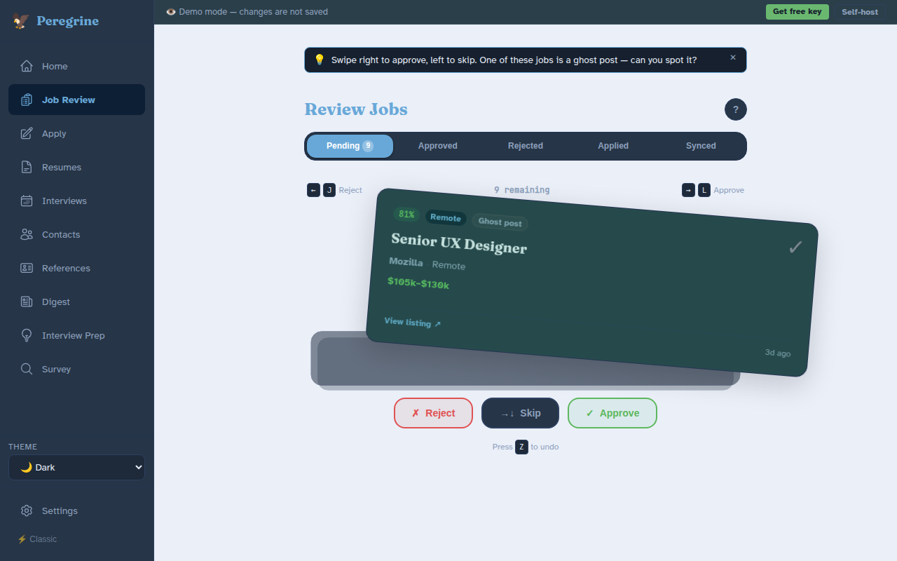
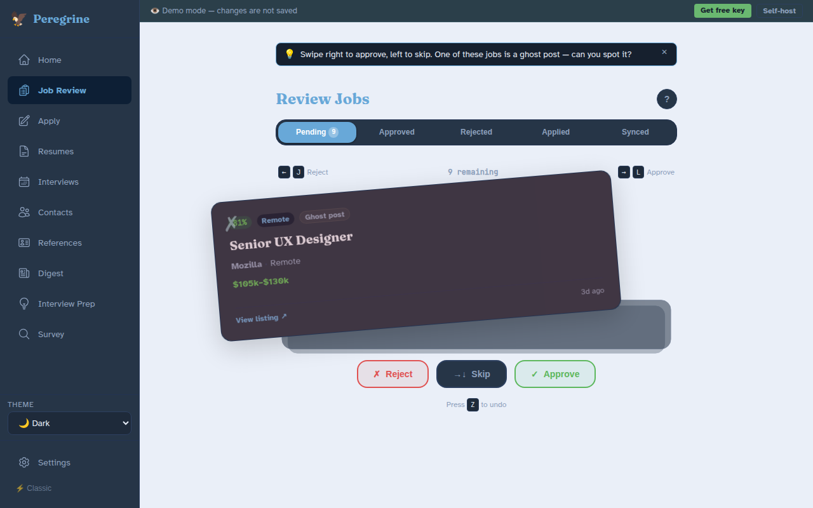
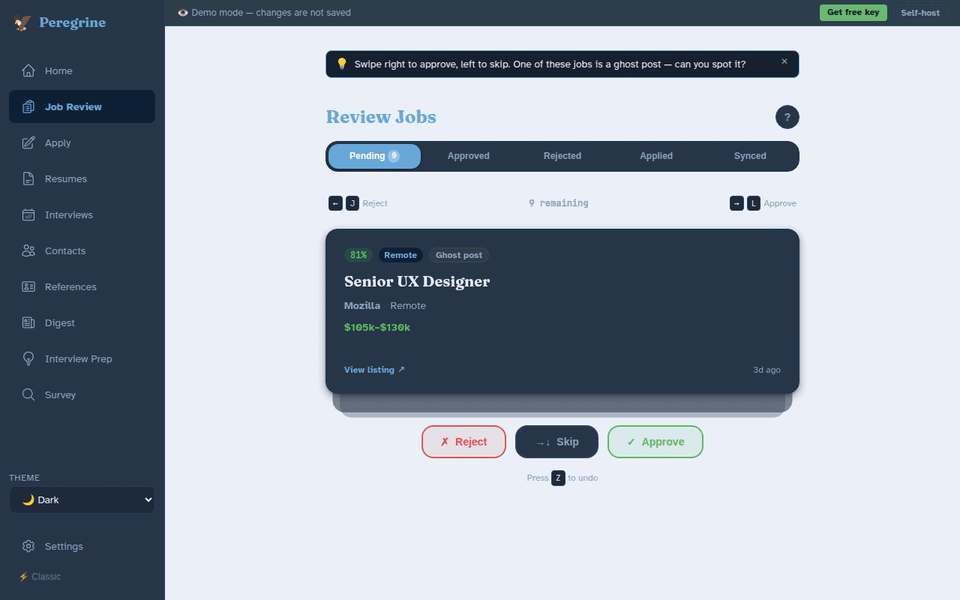

# Job Review

**Job Review** is where you look at newly found jobs, one at a time, and decide which ones are worth applying to.

## What you will do here

1. Click **Job Review** in the sidebar. You see one job card at a time, with the best matches first.
2. Read the card. The title, company, pay and a short description are all on it.
3. Choose **Approve**, **Reject** or **Skip**. The next card appears.
4. Go to **Apply** to write your application for the jobs you approved.

There is no hurry. You can stop at any point and pick up later. Jobs you have not decided on stay in the queue.

## What do the three choices do?

- **Approve** keeps the job and sends it to the **Apply** page.
- **Reject** removes the job from your queue. It moves to the **Rejected** tab.
- **Skip** puts the job at the back of the queue so you can decide later. Nothing is saved or changed.

## How do I approve, reject or skip?

Use whichever way is easiest for you. They all do the same thing.

**With the buttons.** Click **Reject**, **Skip** or **Approve** under the card.

**With the keyboard.**

| Key | What it does |
|-----|--------------|
| Right arrow or **L** | Approve |
| Left arrow or **J** | Reject |
| **S** | Skip |
| **Enter** | Show more or less of the description |
| **Z** | Undo your last choice |
| **?** | Show or hide this list of shortcuts |

The keys do not work while you are typing in a box.

**With a mouse or your finger.** Drag the card toward the right to approve it or toward the left to reject it. The card tints green or red as you drag so you can see what will happen. Let go near the right or left edge of the screen, or flick the card quickly sideways, and it flies off. Let go in the middle and the card slides back with nothing changed.

If you open the full description with **Show more**, the card stops responding to drags so you can scroll. Click **Show less** to swipe again.

## What if I make a mistake?

After every choice a small bar at the bottom of the screen says what happened and offers **Undo**. It stays for about five seconds. You can also press **Z** at any time to undo your most recent choice. Approved and rejected jobs go back to the front of your queue.

## What is on a job card?

- **A percentage badge.** This is the match score. Higher means more of the job's wording lines up with your resume and preferences. Green is 80 or more, amber is 60 to 79, and lower scores look different again.
- **Remote.** Shown if the job can be done from home.
- **Ghost post.** The listing was posted more than 30 days before Peregrine found it, so it may already be filled.
- **Stale.** The listing was posted more than 14 days before Peregrine found it.
- **Pay.** Shown if the listing includes it.
- **Missing keywords.** Words from the job listing that are not in your profile. Up to five show, with a count of any more.
- **View listing.** Opens the original posting in a new tab.
- **Show more.** Opens the full description.

A high score is a hint, not a verdict. You know your situation better than any score does.

## What is the "Matching on" bar?

Above the card you see a row of small labels under **Matching on**. They show what Peregrine is using to score jobs: your locations, minimum pay, remote preference, target job titles and whether you have a resume.

A dashed label with a question mark, such as **Min salary?**, means that item is not set yet. Click **Edit preferences** to fill it in. Better preferences give you a better queue.

## What are the tabs at the top?

The tabs let you look back at jobs you have already sorted. Each shows a count.

- **Pending** is the swipe queue described above.
- **Approved** lists jobs you approved. Each has a **Draft** button that opens the cover letter workspace for that job.
- **Rejected** lists jobs you rejected.
- **Applied** lists jobs you have applied to. **Move to…** lets you update where a job is in the process.
- **Synced** lists jobs that have reached the synced status.

On every tab except **Pending** you can sort by **Best match**, **Newest first** or **Company A–Z**, and tick **Remote only** to hide the rest. **View** opens the original listing.

## What if the queue is empty?

You see **Queue cleared.** That means there is nothing left to review right now. Run a discovery search from the home page to find new jobs. Peregrine loads your best-matching 50 pending jobs at a time.

## Where do approved jobs go?

They appear on the **Apply** page, where you can write a cover letter and track your application. See [Apply Workspace](apply-workspace.md).

??? note "For self-hosters and developers"
    - Job Review is served at `/review`. The tab can be set with a link such as `/review?status=applied`.
    - Pending jobs are fetched with `GET /api/jobs?status=pending&limit=50`, ordered by `match_score` descending. Other tabs use `GET /api/jobs?status=<status>`.
    - Approve calls `POST /api/jobs/{id}/approve`. Reject calls `POST /api/jobs/{id}/reject`. Skip is client-side only: the job moves to the back of the in-browser queue and no status changes.
    - Undo calls `POST /api/jobs/{id}/revert` with the previous status, or just reorders the queue for a skip.
    - Status values used by the tabs are `pending`, `approved`, `rejected`, `applied` and `synced`.
    - The "Matching on" bar reads your search preferences and resume settings. Edit them under **Settings** then **Search** (`/settings/search`).
    - Match score and keyword gaps are produced by the discovery scoring step. See [Job Discovery](job-discovery.md) for how they are calculated.
